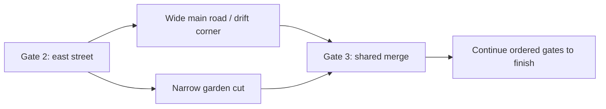

# Suburb circuit builder

The editor authors a closed, playable single-racer circuit with the existing walker,
boost/slipper heat, ordered checkpoints, three-lap race, restart, camera and HUD.
The supplied **Sunday Block Party** recipe creates an approximately 849 m main loop around a
240 × 200 m American suburban block, with rounded intersections, 8–14 m streets,
sidewalks, lawns, porches, garages, picket fences, trees and US street furniture.
The arcade preset has seven shared checkpoint sectors and a narrow garden cut.

Scope review: this directly improves the demo race and track iteration. The human milestone
review is still pending; this request explicitly authorizes the builder and neighbourhood
kit. Simple repeatable meshes are appropriate. Maintenance is limited to recipe data and
editor generation around the existing racing implementation. This is demo tooling; an
in-game editor, online sharing, dynamic hazards and a campaign remain full-game backlog.

## Open and race

1. Open **Granny Racer → Circuit Builder → Open Builder**.
2. Click **Create / open Suburb Square** to select the supplied recipe.
3. Click **Validate**, then **Build playable scene**. Save any current scene when Unity asks.
4. Press **Play**. W/S or arrows accelerate/brake, A/D steer, Space boosts, Shift hops,
   R resets, Escape pauses, and F1 opens the existing handling lab. Controller bindings
   are available in the in-game controls panel.

The generated scene is `Assets/GrannyRacer/Scenes/Tracks/Circuit_SuburbSquare.unity`.
It is also the first enabled Windows build scene. Existing scene-list entries are retained.
Quiet Sunday keeps its separate scene, track definition and mesh assets.

## Shape a circuit

Use **New circuit recipe…** to copy the current recipe into a new asset. In Scene view,
move the numbered route handles, or expand **Control Points** in the builder to edit
coordinates, road widths and checkpoint flags. Unity's list controls add, remove and
reorder points. The route closes automatically: do not duplicate the first point at the end.
Point zero is the finish; keep at least four checkpoints. Ctrl-Z restores recipe edits.

The supplied rounded corners illustrate how to use multiple points around a turn. Sharp
single-point corners can fold the road and will be rejected. Keep the route planar (Y = 0),
widths between 6 and 18 m, and avoid crossings. Validation resamples the actual closed
spline, checks triangle winding, intersecting road/sidewalk outlines and corner clearance, and refuses invalid geometry before
scene generation. This version intentionally rejects elevation because the lawns and lots
share a flat plane.

Rebuild after changing a recipe. Route handles show the control polygon; the built road
shows the resampled result. Each saved recipe owns a generated folder identified by its
Unity GUID. Copying a recipe creates an independent track and scene. Rebuilding retains
existing generated mesh GUIDs. Direct edits to the **generated scene** are overwritten;
store intentional additions in the recipe's **Extra Assets** list.

## Add more assets

Expand **Palette**, add a row, drag an imported model or prefab from the Project window,
and set its role, scale and rotation:

- **House**, **Tree**, **Fence**, and **Street Furniture** enter the corresponding repeated
  roadside placement groups. The seed makes a layout repeatable.
- **Landmark** assets are available for explicit placement rather than random repetition.

Use **Place extra assets**, select a prefab/model and hold **Shift-click** in Scene view to
place it on the one-metre ground grid. Turn placement mode off to move its orange handle.
Rotation, scale and position can also be edited in **Extra Assets**. Delete its list row to
remove it. These placements survive rebuilds and are placed before automatic scenery.

Validation checks the complete renderer bounds, including scale, rotation and imported
pivot offsets, against the road plus sidewalk clearance. The shortcut is included in clearance checks. Automatic lot placements are
skipped if their footprints intersect another placed asset or encroach on the circuit.
All lot art is decorative; prefab colliders are removed from generated instances, and
race containment uses the continuous boundary at the far side of each sidewalk. This
prevents a newly added decorative prefab from accidentally blocking a race.

Prefabs should contain static, opaque environment renderers and no runtime behaviour.
Asset placement wraps the imported hierarchy, preserving FBX axis conversion, and aligns
its lowest renderer bound with the lawn. For new FBXs, review units, transforms, normals,
materials and import settings using the documented Blender pipeline before adding them.

## Road and scenery construction

The asphalt uses one closed ribbon mesh and one static MeshCollider. Curb ramps and
sidewalks reuse its exact edge coordinates, including the last-to-first seam. Curbs rise
0.13 m over 0.35 m; sidewalks extend to 3.2 m outside the road. A 1.05 m boundary
contains the circuit, with deliberate openings at the garden-cut mouths. Ground sits 0.03 m below the road and expands to cover authored extras.
Generation happens in the editor; no track generation runs during gameplay.

The new Blender kit complements the ten existing Rocket Club assets. Exported additions:

| Asset | Source triangles | Blender dimensions X × depth × height (m) |
|---|---:|---|
| Ranch house | 2,132 | 9.683 × 8.650 × 4.750 |
| Colonial house | 3,428 | 9.683 × 8.650 × 7.797 |
| Garage | 836 | 6.680 × 6.700 × 4.696 |
| US mailbox | 728 | 0.578 × 0.820 × 1.710 |
| Fire hydrant | 920 | 0.480 × 0.480 × 0.980 |
| Streetlamp | 560 | 0.650 × 1.440 × 5.170 |
| Street sign | 708 | 1.500 × 1.500 × 2.900 |
| Hedge | 1,400 | 3.749 × 0.952 × 1.360 |

Total source cost: **10,712 triangles**, one palette material and one UV layer per asset.
Unity imports **10,338 triangles** after importer processing; the per-mesh audit records the
actual import dimensions and material counts. Validation found no blocking errors or asset
warnings. Blender emitted these API deprecation notices during generation/validation:

```text
DeprecationWarning: 'World.use_nodes' is expected to be removed in Blender 6.0
DeprecationWarning: 'Material.use_nodes' is expected to be removed in Blender 6.0
```

Sources are in `Blender/Source/Environment/ENV_SuburbCircuit_Kit.blend`; the generator is
`Blender/Scripts/build_suburb_circuit_kit.py`. It refuses to overwrite an existing source.
Exports stage in `Blender/Exports/SuburbCircuit/`, each with a manifest. The local Blender
folders remain ignored by Git under D-09; imported assets and these reports are tracked.
New sources require a versioned filename before regeneration.

`CircuitSceneBuilder.ImportKit` imports the staged kit through Unity APIs, configures scale,
file units, imported normals, calculated tangents, no animations/cameras/lights, no automatic
colliders, compression off, read/write off, and shared palette material remapping. It uses
point-filtered, uncompressed, sRGB palette sampling. No Unity packages are added.

The route-handle API follows [Unity's Handles.FreeMoveHandle documentation](https://docs.unity3d.com/6000.0/Documentation/ScriptReference/Handles.FreeMoveHandle.html).

## Review and evidence

- [Blender mesh preview](Art/Previews/circuit_kit.png)
- [Unity circuit overview](Art/Previews/circuit_overview.png)
- [Unity driving-camera preview](Art/Previews/circuit_driver.png)
- [Source validation](Art/ENV_SuburbCircuit_Kit.validation.json)
- [Export manifest](Art/CIRCUIT_EXPORT_MANIFEST.json)
- [Unity import audit](Art/CIRCUIT_IMPORT_AUDIT.json)
- [Circuit build report](Art/CIRCUIT_BUILD_REPORT.json)

Human review remains required: drive three laps using keyboard and controller; boost through
corners; ride both sidewalks; reset near every checkpoint; finish and restart; add a custom
asset, rebuild and verify its position; inspect porch, mailbox, curb and house silhouettes
from the actual camera. Automated driving and renders do not establish handling feel,
visual quality, humour or performance acceptance. New audio is deferred; the existing POC
voice/boost feedback is reused. Street signs currently have colour panels without lettering.


## Mario Kart-inspired racing and checkpoint design

The owner requested Mario Kart as the gameplay and level-design reference. The selected
principles are timed starts, charged drift exits, off-line boost panels, a narrower optional
route, off-road slowdown that boosting can overcome, forgiving recovery, and readable
sector gates. Nintendo describes the driving systems in its
[fundamentals guide](https://www.nintendo.com/jp/ichikara/aabpa/index_en.html) and
[advanced techniques guide](https://www.nintendo.com/jp/ichikara/aabpa/02_en.html).
The checkpoint implementation below is our own design; it is not a claim about Nintendo's
internal checkpoint code.

The project already implements timed launches and hop/hold/release charged drifts. The
circuit adds original **Rocket Strips**, with gold chevrons, a forward-entry speed impulse,
rocket VFX and HUD feedback. They sit off the centre line on long straights, leaving room
to choose a passing line and brake for the following corner. Pads have editable speed gain
and duration, reject reverse entry and countdown/finished racers, and clear on race reset.

The main street varies from a 14 m start straight to an 8 m narrow section. Both sidewalks
are legal alternatives. The 4.5 m garden cut between the east and north streets is shorter
but requires a narrower entry/exit. Its pavement rises with the sidewalk and blends back
to the asphalt. Lawn slows the racer to 55% of its normal speed limit; boosting temporarily
bypasses that penalty, making slipper heat part of the shortcut decision.

**Checkpoints are progress gates, not precision targets.** The trigger covers the road,
both sidewalks and an 8 m vertical range for hops. The racer centre must cross the gate's
plane in the forward direction. Backwards entries, repeated touches, resets beyond the
plane and out-of-order gates do not advance the race. A legal branch must split and rejoin
inside one checkpoint sector; recipe validation rejects an intermediate checkpoint that
the shortcut would bypass. The supplied preset places a shared gate at the merge.

A valid crossing updates the next-gate HUD, displays the sector time, and stores a reset
pose 3 m beyond the gate, 0.9 m above the centreline, facing along the route. The finish
still counts only after the full ordered sequence. Sector times and gate feedback reset
with the race. The HUD uses the recipe's course name and chosen lap count.

Enable **Driveway Shortcut** and set its two control-point indices to author another branch.
The start must precede the end; branches cannot wrap across the finish or cross an unrelated
street. Remove optional checkpoint flags inside a branch sector and retain a shared gate
at/after its merge. **Arcade Features** controls Rocket Strips; forward sector validation
remains enabled for generated circuits.

Items/combat, AI opponents, slipstreaming, gliding, anti-gravity and elimination races have
not been added. They require separately scoped gameplay systems and the project's human
milestone gate. This deliverable exercises racing lines and mechanics in the single-racer
POC; it cannot establish whether overtaking is balanced against opponents.


The branch progression is deliberately simple:



The start gate is checkpoint zero internally. Displayed gates 1–6 lead back to the finish.
The garden cut saves approximately 56 m of centreline distance; entry/exit speed, braking,
boost use and actual line choice determine whether it saves time in play.


## Validation record (2026-09-08)

- Latest EditMode run: **93/93 passed**, no skipped tests.
  `Logs/unity-editmode-20260908-233300.log` and matching results XML.
- The first expanded PlayMode run passed **38/39**. The failure was
  `RaceStartPlayModeTests.PressingInsidePerfectWindowProducesTurboAndRocketEffects`:

  ```text
  Expected: Turbo
    But was:  None
  ```

  The same timed-start fixture then passed **2/2** in isolation, without a gameplay change.
  This indicates intermittent test behaviour; the failed full run remains recorded here.
  All six circuit tests passed in that run, including physical main-road and shortcut laps,
  seam/sidewalk coverage, backwards/airborne gate passage, pad boost/reset and lawn slowdown.

The Unity wrappers also surfaced environment log messages during that failed test run:

```text
[Licensing::Module] Error: Access token is unavailable; failed to update
Exception occured while accepting client connection: System.IO.IOException: Le canal de communication est sur le point d'être fermé.
```

They did not prevent compilation or the test run. An existing POC asset-creation path also
emitted the following warning during initial circuit generation:

```text
CreateAsset() should not be used to create a file of type 'physicsMaterial' - consider using AssetDatabase.ImportAsset() to import an existing 'physicsMaterial' file instead or change the file type to '*.asset'. This error will in a future release be changed to an exception.
```

The existing physics-material identity was preserved. Existing test files also produce
obsolete `FindObjectsSortMode` API warnings. These are separate from the new circuit checks.


The final complete rerun passed **39/39 PlayMode tests**, with no skips:
`Logs/unity-playmode-20260908-232603.log` and
`Logs/test-results-playmode-20260908-232603.xml`.
The final source also passed **93/93 EditMode tests**. No gameplay changes were made to
force the timed-start assertion to pass; the intermittent earlier failure remains a known
test failure to monitor; its cause is unconfirmed.


Windows development build: **Succeeded**, 0 errors, 1 warning, 177 MB, approximately 49 s.
`Logs/unity-build-development-20260908-233043.log` contains `[Build] OK` and the successful
BuildPipeline result. The shell wrapper returned exit code **143** after the build; Unity's
log and the produced executable were checked independently. The standalone player then
launched, exercised driving/boost/pause/handling UI, captured six screenshots and exited
with code **0**. `Logs/circuit-player-review.log` reported racing with grounded contact.
The build warning was:

```text
Access token is empty. Native symbols will not be uploaded for this build. Please make sure you are signed in to the Unity Cloud.
```

This concerns optional symbol upload. The local Windows executable is
`Builds/Windows-Development/GrannyRacer.exe`.

[Actual Windows player driving capture](Art/Previews/CircuitPlayer/02_driving.png) ·
[Boost capture](Art/Previews/CircuitPlayer/03_boost.png) ·
[Pause capture](Art/Previews/CircuitPlayer/04_pause.png).
